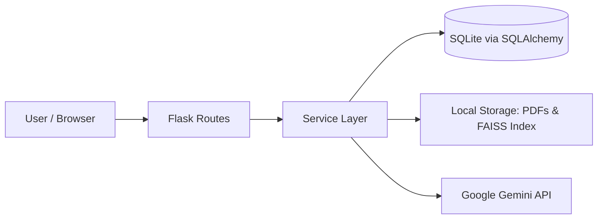
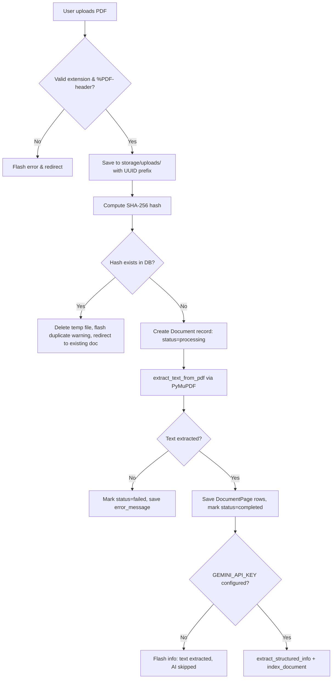
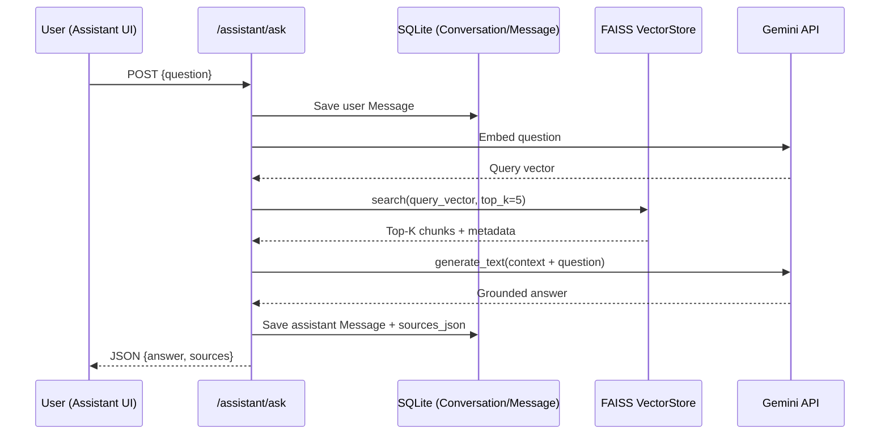

# DocuMind AI — System Workflows & Architecture Guide

This document describes the end-to-end workflows of **DocuMind AI**, explaining how requests move through the Flask routes, services, SQLite database, Google Gemini API, and FAISS vector store.

---

## Project Pitch & Interview Summary

### 30-Second Overview
**DocuMind AI** is an enterprise document intelligence web application. Instead of manually reading PDFs (such as invoices or purchase orders) and typing data into spreadsheets, users upload PDFs and the system automatically:
1. Extracts text page-by-page.
2. Pulls out structured business fields (supplier, invoice number, dates, totals) using an LLM.
3. Indexes the content for semantic search.
4. Lets users ask questions in natural language with exact document and page-number citations, or export extracted data to CSV.

### Technical Summary (3 Key Points)
1. **Ingestion & Validation:** Flask + SQLAlchemy (SQLite) validates PDFs, prevents duplicates via SHA-256 hashing, and extracts text page-by-page with PyMuPDF (with optional Tesseract OCR fallback).
2. **Structured Extraction:** An abstracted `LLMProvider` (using Google Gemini) converts unstructured document text into validated JSON fields, which users can inspect and manually correct.
3. **RAG Pipeline:** Documents are split into overlapping chunks, embedded with `gemini-embedding-001`, and stored in a FAISS vector index so the AI Assistant answers strictly from uploaded documents with source citations.

---

## 1. High-Level System Flow

---

## 2. Document Upload, Validation & Ingestion Workflow

**Entry point:** `POST /documents/upload` in [app/routes/documents.py](file:///d:/Programming/AI%20Projects/app/routes/documents.py)

### Step-by-Step Breakdown
1. **Validation (`app/utils/validators.py`)**:
   - `allowed_file()` checks the `.pdf` extension.
   - `is_valid_pdf_header()` verifies the file starts with `%PDF-` magic bytes.
2. **Safe Storage & Deduplication**:
   - `generate_stored_filename()` prepends a UUID4 hex string to `secure_filename()`.
   - `compute_file_hash()` computes a SHA-256 digest and checks `Document.file_hash` in SQLite. Duplicates are immediately removed from disk and redirected to the existing record.
3. **Text Extraction (`app/services/pdf_extractor.py`)**:
   - Opens the PDF with PyMuPDF (`fitz.open()`), iterates page-by-page, and extracts text.
   - If a page has fewer than `MIN_TEXT_LENGTH_PER_PAGE` (20) characters, it checks `is_ocr_available()` (`app/services/ocr_service.py`). If Tesseract is installed, it renders the page at 200 DPI and runs `pytesseract.image_to_string()`. If Tesseract is not installed, it honestly reports `insufficient_text` without faking OCR.
4. **AI Extraction & Indexing**:
   - If `GEMINI_API_KEY` is configured, it runs structured field extraction and RAG indexing automatically.

---

## 3. Structured Information Extraction Workflow

**Entry points:**
- Automatic during `POST /documents/upload`
- Manual trigger via `POST /documents/<doc_id>/extract` in [app/routes/documents.py](file:///d:/Programming/AI%20Projects/app/routes/documents.py)
- Manual correction via `POST /documents/<doc_id>/fields/update`

**Service:** `extract_structured_info()` in [app/services/information_extractor.py](file:///d:/Programming/AI%20Projects/app/services/information_extractor.py)

1. **Prompt Construction**: Concatenates all `DocumentPage.extracted_text` entries (up to 25,000 characters) with page markers and instructs the LLM to return JSON for 14 standard business fields (`document_type`, `supplier_name`, `document_number`, `invoice_number`, `purchase_order_number`, `document_date`, `due_date`, `currency`, `total_amount`, `tax_amount`, `customer_name`, `supplier_contact`, `products_or_services`, `important_terms`), using `null` for missing values.
2. **Structured JSON Call**: Calls `GeminiProvider.generate_json()` (`response_mime_type="application/json"`).
3. **Validation & Normalization**:
   - `_normalize_numeric()` strips currency symbols/commas from `total_amount` and `tax_amount` and formats them to 2 decimal places (or `None` if invalid).
   - Replaces any prior `ExtractedInformation` rows for that `document_id` and updates `Document.document_type`.
4. **Manual Inspection & Editing**: Users can review and edit any extracted field on the Document Detail page; saving updates `ExtractedInformation.field_value` in SQLite.

---

## 4. RAG Indexing & Question-Answering Workflow

### 4A. Indexing (`index_document` in [app/services/rag_service.py](file:///d:/Programming/AI%20Projects/app/services/rag_service.py))
1. **Chunking (`app/services/embedding_service.py`)**: `create_document_chunks()` splits each `DocumentPage` into overlapping character chunks (`CHUNK_SIZE=1000`, `CHUNK_OVERLAP=200`) and persists `DocumentChunk` rows.
2. **Embedding (`app/services/llm_provider.py`)**: `GeminiProvider.embed_texts()` generates embedding vectors using `text-embedding-004`.
3. **Vector Storage (`app/services/vector_store.py`)**: `VectorStore.add_vectors()` L2-normalizes vectors and adds them to a FAISS `IndexFlatIP` index (cosine similarity), persisting `index.faiss` and `metadata.json` in `storage/vector_index/`.

### 4B. Question Answering (`POST /assistant/ask` in [app/routes/assistant.py](file:///d:/Programming/AI%20Projects/app/routes/assistant.py))

1. **Session History**: `_get_or_create_conversation()` links the browser session (`chat_session_id`) to a `Conversation` row and stores every user/assistant `Message`.
2. **Retrieval & Grounding**:
   - If the vector index is empty, `answer_question()` immediately returns: *"The uploaded documents do not contain enough information to answer this question."*
   - Otherwise, retrieved chunks are formatted with `[Source: <document_name>, Page <page_number>]` headers and passed to `GeminiProvider.generate_text()` with a strict system prompt forbidding unsupported assumptions.
   - Deduplicated source badges (`document_name`, `page_number`, `excerpt`) are returned alongside the answer.

---

## 5. Document Deletion Workflow

**Entry point:** `POST /documents/<doc_id>/delete` in [app/routes/documents.py](file:///d:/Programming/AI%20Projects/app/routes/documents.py)

1. Deletes the physical PDF from `storage/uploads/`.
2. Calls `VectorStore.delete_document_vectors(doc.id)` to rebuild the FAISS index without that document's vectors.
3. Deletes the `Document` row in SQLite, which cascades to `DocumentPage`, `DocumentChunk`, and `ExtractedInformation`.

---

## 6. CSV Export & Reporting Workflow

**Entry points:** `GET /exports/extracted` and `GET /exports/csv` in [app/routes/exports.py](file:///d:/Programming/AI%20Projects/app/routes/exports.py)

1. `_build_extracted_rows()` joins each `Document` with its `ExtractedInformation` key-value pairs.
2. `export_csv()` uses Python's `csv.DictWriter` into an in-memory `io.StringIO` buffer—ensuring commas, quotes, and special characters are properly escaped—and returns `documind_extracted_data.csv` with `Content-Disposition: attachment`.
